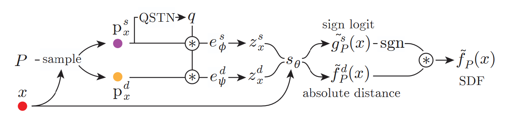

# Design Notes

## Datasets

#### ABC Train - 5,050
contains:
- point cloud inputs
- query locations
- ground-truth query distances (i.e. supervised labels)

#### ABC Test - 300
100 clean, 100 noisy, 100 extra noisy
contains:
- point cloud inputs
- ground-truth meshs

For tests, the model generates sdf from point cloud, creates sdf grid, runs marching cubes, and evaluates accuracy between meshes (Chamfer, L2, F1, etc.)
### Famous Test - ...

## Network Architecture
Our network architecture is similar to Point2Surf's (fig 1.), with variations exploring different combinations of p_x^s/e_phi^s and p_x^d/e_psi^d to explore local and global information fusion, and with additional attention-pooling for each e_i^j -> z_x^j. Point-wise attention will be explored as well if there is time.

*Figure 1: Point2Surf Architecture*

## Metrics
#### Per mesh:
- number of traingles
- number of vertices
- watertightness (closed)
- number of connected components
- genus of largest component
- area fraction of largest component

#### Per mesh test:
- Symmetric L2-Squared Chamfer Distance (point-to-point, knn on 10k pts)
- F-Score (threshold tbh)
- watertightness consistency
- genus consistency

#### Per data set:
- mean Symmetric L2-Squared Chamfer Distance
- mean F-Score
- % watertightness consistency
- % genus 1 consistency
- % genus 2 consistency
- train time
- inference time
- network memory size 